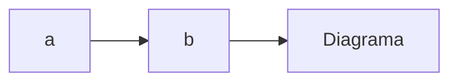

# Nome da Matéria

## Nome do Capítulo

Texto extenso

Nome - Definição

---

Quebra de Linha ^^^

Tópico

- Subtópico 1

- Subtópico 2 - Com definição
  
  - Sub-Sub Tópico
  
  - Subsub Tópico 2
    
    - E assim em diante...

- Voltou

Texto em **negrito**

Texto em *itálico*

Texto em <u>underline</u>

Imagem

Fórmula - $x=\frac{-b\pm\sqrt{b^2-4\cdot a\cdot c}}{2\cdot a}$

